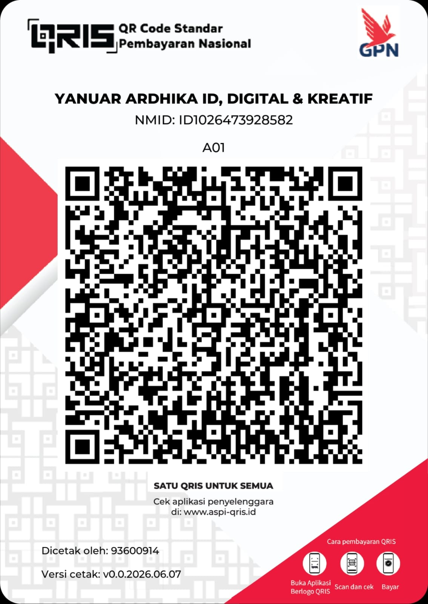

# 💬 Dukungan & Bantuan Teknis (Support)

Terima kasih telah mengunjungi dan menjelajahi repositori **Modern Interactive Portfolio & Engineering Showcase** karya **Yanuar Ardhika Rahmadhani Ubaidillah (@ardhikaxx)**.

Dokumen ini menjelaskan kanal komunikasi resmi, pedoman meminta bantuan teknis, peluang kolaborasi/jasa kustomisasi perangkat lunak, serta cara memberikan apresiasi atau donasi.

---

## 📬 Kanal Komunikasi Resmi

Jika Anda memiliki pertanyaan seputar arsitektur teknis, mendapati bug pada website, atau ingin mendiskusikan peluang kolaborasi/proyek, silakan gunakan kanal resmi berikut:

* **Pemilik & Pengembang Utama**: **Yanuar Ardhika Rahmadhani Ubaidillah (@ardhikaxx)**
* **Email Resmi**: `ardhikayanuar58@gmail.com`
* **GitHub Issues**: [github.com/ardhikaxx/portofolio-nextjs/issues](https://github.com/ardhikaxx/portofolio-nextjs/issues)
* **GitHub Discussions**: [github.com/ardhikaxx/portofolio-nextjs/discussions](https://github.com/ardhikaxx/portofolio-nextjs/discussions)
* **Repositori Resmi**: [github.com/ardhikaxx/portofolio-nextjs](https://github.com/ardhikaxx/portofolio-nextjs)
* **Live Demo**: [portofolio-nextjs-eight.vercel.app](https://portofolio-nextjs-eight.vercel.app)

---

## 📚 Sumber Dokumentasi Mandiri

Sebelum mengajukan pertanyaan atau membuat issue baru, sangat disarankan untuk memeriksa dokumen pendukung berikut yang telah disediakan di repositori:

1. [📖 **README.md**](./README.md) — Gambaran umum proyek, fitur utama, teknologi, panduan instalasi lokal, dan showcase proyek.
2. [📋 **CHANGELOG.md**](./CHANGELOG.md) — Riwayat perubahan, rilis versi, dan penambahan fitur secara kronologis (*Keep a Changelog* & SemVer).
3. [🛡️ **SECURITY.md**](./SECURITY.md) — Kebijakan keamanan, versi yang didukung, dan prosedur pelaporan celah keamanan (*Responsible Disclosure*).
4. [🤝 **CONTRIBUTING.md**](./CONTRIBUTING.md) — Panduan kontribusi kode, standar commit Git, dan alur pembuatan pull request.
5. [📜 **CODE_OF_CONDUCT.md**](./CODE_OF_CONDUCT.md) — Pedoman etika dan norma interaksi dalam komunitas pengembang.
6. [📚 **CITATION.md**](./CITATION.md) & [**citation.cff**](./citation.cff) — Format sitasi akademik karya portofolio untuk riset, skripsi, atau publikasi ilmiah.
7. [⚖️ **LICENSE**](./LICENSE) — Ketentuan hukum penggunaan perangkat lunak (MIT License).

---

## 🧭 Sebelum Mengajukan Masalah (Troubleshooting Guide)

Jika Anda mencoba menjalankan repositori ini secara lokal di komputer Anda dan mengalami kendala:

1. **Pastikan Versi Node.js Sesuai**: Proyek ini memerlukan **Node.js versi 18.18.0 atau yang lebih baru** (disarankan Node.js LTS v20.x). Cek dengan menjalankan `node -v`.
2. **Bersihkan Cache dan Dependensi**: Jika terjadi error kompilasi dependensi:
   ```bash
   rm -rf .next node_modules package-lock.json
   npm install
   ```
3. **Jalankan Verifikasi Build**:
   ```bash
   npm run build
   ```
   Pastikan tidak ada galat TypeScript atau ESLint yang tertinggal.
4. **Sertakan Konteks Lengkap**: Saat membuat *Issue* di GitHub, sertakan:
   * Versi Node.js dan sistem operasi yang Anda gunakan (Windows/Linux/macOS).
   * Tangkapan layar (*screenshot*) atau log output terminal yang menunjukkan galat.
   * Langkah-langkah detail untuk mereproduksi galat tersebut.

---

## 💼 Layanan Profesional & Kustomisasi Web

Tertarik membangun website portofolio interaktif, landing page performa tinggi, sistem informasi manajemen (SIM / ERP / POS), atau aplikasi web berbasis AI untuk institusi/bisnis Anda?

Keahlian & layanan yang dapat disediakan meliputi:
* **Pengembangan Web Modern**: Next.js (App Router), React 19, TypeScript, Tailwind CSS, Laravel, Node.js, Python.
* **Optimasi SEO & Core Web Vitals**: Peningkatan skor Google PageSpeed Insights (FCP, LCP, CLS, INP), structured data (Schema.org), dynamic sitemap & Open Graph.
* **Desain UI/UX Interaktif**: Desain responsif, animasi interaktif (Framer Motion, Canvas, CSS3), mode gelap/terang adaptif.
* **Integrasi Sistem & API**: Restful API, payment gateway (QRIS, Midtrans, dsb.), CMS custom, dan integrasi kecerdasan buatan (AI/LLM).

Silakan hubungi melalui email: **`ardhikayanuar58@gmail.com`** untuk konsultasi teknis maupun negosiasi proyek.

---

## 💖 Dukungan & Donasi

Jika karya portofolio, arsitektur kode, template, atau tutorial yang dibagikan dalam repositori ini bermanfaat bagi Anda dan telah menghemat waktu kerja atau belajar Anda, Anda dapat menunjukkan apresiasi dan traktiran kopi (donasi sukarela) kepada pengembang melalui pemindaian kode **QRIS** di bawah ini:

<p align="center">
  
</p>

> [!NOTE]
> Donasi sepenuhnya bersifat sukarela (*voluntary*) dan tidak mengikat. Seluruh kode open source dalam repositori ini tetap dapat dipelajari dan diakses secara bebas sesuai ketentuan lisensi MIT.

Terima kasih atas segala bentuk dukungan, bintang (*star*), dan apresiasi Anda!

---

**Yanuar Ardhika Rahmadhani Ubaidillah (@ardhikaxx)**  
*Full Stack Software Engineer & Open Source Contributor*
